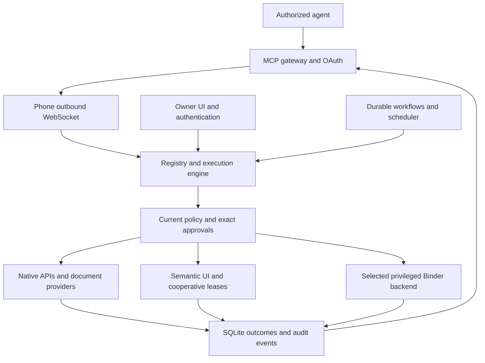

# SIConnect source audit and implementation priorities

October 26, 2026. Source baseline: `30d0715`. Android source is **0.6.0-dev.5 / 13**, database schema **10**, with **85** registered tools. This checkpoint adds source fixes and host verification; installed-device evidence remains in [engineering pass 12](engineering-pass-12.md).

SIConnect has a working execution platform: authorization, durable requests, approval binding, native resource operations, privileged execution, declarative workflows and an authenticated gateway. The continued host implementation separates workflow recovery from readiness, bounds continuation dispatch and coordinates reminder cancellation with its original delivery request. The next priorities are bounded storage, shared readiness measurements, client retry identity and connection transitions.

## Scope and architecture

The review traced request submission through authentication, policy, persistence, owner review, dispatch, cancellation, verification and result retrieval. It also covered workflow continuation, scheduler dispatch, native files/documents/calendar, screen leases, accessibility, notification actions, local ADB bootstrap, the five owner sections, build workflows and gateway dependencies. The bundled ADB boundary received a focused protocol/lifecycle review; this is not an independent cryptographic audit.

| Area | Current implementation | Main remaining concern |
| --- | --- | --- |
| Core | Pure Kotlin registry, bounded schema validation, current-grant checks, immutable operation fingerprints, state CAS, durable skill cursors and proposal links | Device acceptance of bounded recovery and concurrent failure handling |
| Persistence | SQLite migrations through schema 10; indexed history projections; request transitions and audit writes share transactions | Full request/workflow storage grows without a production retention flow |
| Execution | Native APIs; explicitly selected direct Binder or Shizuku; bounded subprocess capture and reliable result pipes | Blocking provider/Binder cancellation and platform dispatch races |
| Screen and notifications | Agent-bound semantic references; protected surfaces; password exclusion; live notification-action identity checks | Full lifecycle matrix and verified business outcomes |
| Scheduling | Stable scheduled slots, frozen run snapshots, recurrence/timezones, missed-run policies, one-off runs, health alerts | Physical AlarmManager/WorkManager and cancellation acceptance |
| Gateway | OAuth/PKCE or private bearer, acknowledged device socket generations, bounded pending calls, original-request recovery guidance | Caller-controlled retry identity and network recovery latency |
| Owner UI | Adaptive navigation, agent permissions, Inbox, automation forms, paged activity, setup/recovery | Large-font/Fold verification, consistent action feedback and result presentation |

## Implemented fixes

| Finding | Previous behavior | Change and verification |
| --- | --- | --- |
| Cancellation during assessment | A cancellation could win while submission still attempted a transition from `CANCELLED` to pending approval, throwing an illegal-transition error | Submission returns the winning record and avoids posting an approval for that cancelled path. Reproduced and covered in [AuditRegressionTest][audit-tests]. |
| Deadline during dispatch checks | Availability/policy checking could consume the remaining deadline and still start the backend | Deadline is checked after revalidation and again when the execution coroutine starts. Reproduced and covered in [AuditRegressionTest][audit-tests]. |
| Dynamic effects after failed verification | The failed-verification branch ignored dynamically assessed risk/effects that the exception branch already considered | Both branches use the same side-effect predicate and preserve `UNKNOWN_OUTCOME`. Reproduced for raised risk and assessed effects in [AuditRegressionTest][audit-tests]. |
| Workflow timeout during a mutation | Requesting child cancellation could immediately mark the workflow failed while the child was still executing | Nonterminal or unknown child outcomes retain workflow uncertainty and prevent later steps. Reproduced and covered in [AuditRegressionTest][audit-tests]. |
| Long workflow identities | A valid parent ID could produce a child ID longer than the engine's 200-character limit | Oversized child IDs use a stable SHA-256 identity; existing shorter IDs remain unchanged. Previously saved oversized pending cursors migrate to that addressable identity. Execution, duplicate start, recovery and approval cancellation are covered in [AuditRegressionTest][audit-tests]. |
| Maintenance failure isolation | A scheduler/reminder storage exception could terminate a long-lived collector or the entire expiration/continuation loop | Reconciliation stages isolate ordinary exceptions, preserve coroutine cancellation and retry eligible `READY` workflows on the existing tick. Failure isolation is covered in [RuntimeRecoveryTest][recovery-tests]; Android orchestration still needs device failure injection. |
| Shell permission reduction | Choosing approval-required arbitrary shell erased every standing grant, including unrelated semantic/native allowances | Only arbitrary-shell exceptions and shell standing commands are removed. Other grants survive. Policy behavior and preserved authority are covered in [ShellPermissionTest][permission-tests]. |
| Owner action feedback | MainActivity action errors/status were rendered only on Home | A dismissible shared snackbar presents feedback across destinations; the shell dialog also displays its action error. Android build/lint pass; layout and authentication feedback await device review. |
| Reminder details | Home reminder cards had no route to the existing detail/precise-timing dialog | Cards now open that dialog through an IO-backed lookup. Device interaction remains pending. |
| Standing-grant descriptions | Every displayed standing permission was labeled as exact arguments | UI distinguishes exact reviewed actions, constrained grants and capability allowances. |
| OAuth setup instructions | Consent directed owners to controls from an older UI | Consent points to Agents and distinguishes new pairing from reconnecting an existing identity. Gateway integration checks pass. |
| Signed artifact metadata | The signing workflow hard-coded database version 9 while source uses 10 | Metadata derives the schema version from its authoritative declaration. Embedded workflow Python parses and resolves version 10 locally; the hosted signing workflow was not dispatched. |
| Startup and continuation dispatch | Recovered execution and long child waits could block readiness or event consumers | Startup now prepares persisted cursors without running steps. Bounded workers coalesce signals, yield fairly, retain engine ownership and use durable maintenance after queue saturation. Covered by RuntimeDispatchTest and RecoveryDispatchTest. |
| Reminder cancellation and ordering | Cancellation could leave approval executable, rewrite a completed outcome or race an older platform dispatch | ReminderLifecycle serializes per-identity mutations/dispatch and admits delivery without holding its lock through execution. Cancellation targets the original request, persists CANCELLING when still in flight and retains terminal/unknown outcomes. Eleven controlled host cases cover approval, mutation, recovery, conflicts and update/cancel/restore ordering. Real OS dispatch acceptance remains pending. |
| Workflow language validation | Malformed conditions could install; output references were unchecked and output time resolved to null | Installation validates condition fields/arity, output roots/step references, approval budgets and template payload bounds. Legacy invalid conditions fail before that step executes. Output uses the frozen workflow start time. Six host cases cover these boundaries. |
| Managed UTF-8 reads | A byte limit could split a codepoint and silently create replacement text | Managed files and SAF share strict UTF-8 decoding with explicit dropped-byte counts. Three filesystem tests cover every boundary of multibyte text, invalid bytes and binary preservation. |
| Gateway development dependencies | The full npm audit reported four advisories through body-parser and Undici/Miniflare/Wrangler | Pin Wrangler 4.153.0 and compatible Workers types 5.20261023.1; refresh body-parser to 2.4.0 and Undici to the resolved patched version. Clean install, gateway tests, typecheck, bundle and npm audit pass. |

The first five core defect cases failed against the baseline implementation before their fixes. Additional long-ID cases cover cancellation and recovery of a previously saved oversized pending cursor. Thirty-eight host regression tests were added in total, including 27 in the continued implementation.

The dependency findings were confined to development dependencies: the production-only baseline npm audit reported zero. Advisory context: [body-parser compressed-request denial of service](https://github.com/advisories/GHSA-27r3-jxmh-p828), [Undici EventSource resource exhaustion](https://github.com/advisories/GHSA-4qv8-2p9j-2685), and the [Wrangler 4.153.0 release](https://github.com/cloudflare/workers-sdk/releases/tag/wrangler%404.153.0). The final full dependency audit reports zero known vulnerabilities at this checkpoint.

## Open correctness and recovery work

Priorities below distinguish source-confirmed behavior from concurrency risks that still need a controlled reproduction. P1 should precede feature expansion; P2 belongs in the next improvement pass.

### P1 Bound retained execution data

Source-confirmed: [SqlRequestStore.prune][database] exists but has no production caller. Skill runs, step results, automation history and notification deduplication claims have no production cleanup path. Event trimming alone does not bound the database. Large results are stored in full even when [ResultEnvelope][envelope] limits outbound transport.

Add an explicit owner retention policy and incremental maintenance. Preserve active references, uncertain outcomes and deduplication identity. Include large records and nested request retrieval in storage-limit tests so an outbound chunk limit does not conceal an unreadable SQLite row. Measure growth over representative repeated automations before choosing defaults.

## Open performance and connectivity work

### P2 Expose a stable retry identity to MCP callers

Source-confirmed: [serveMcp][gateway] generates a new UUID for every tool call and does not forward a caller-supplied idempotency key. Engine deduplication protects repeated identities, but a fresh MCP retry can create a different mutation. Reminders, notifications and proposals have their own explicit deduplication keys; other mutations do not share that affordance.

Design a consistent client operation identity without colliding with capability arguments. Test both supported SDK generations: same operation executes once, changed arguments conflict, and lost outcomes resolve to the original device record. Keep unknown mutations out of automatic retry queues.

### P2 Wake reconnection on a usable network transition

Source-confirmed: [GatewayConnection][connection] reconnects using socket failure/handshake callbacks and jittered exponential delay up to roughly 256 seconds. It has no active-network observer to wake that delay when connectivity returns. Local ADB recovery has its own Wi-Fi observer; it does not manage the remote gateway.

Add a lifecycle-owned, coalesced network signal and preserve socket generations, saved enrollment and original request outcomes. Measure Wi-Fi/cellular/offline/captive-portal transitions on the device before setting a reconnect target. Do not reconnect by resubmitting interrupted actions.

### P2 Separate static discovery from provider readiness probes

Source-confirmed: [ControlCenterState][state] rebuilds `registry.statuses()` on request/workflow events. [DocumentOperations][documents] checks saved roots and provider availability for individual document capabilities; availability detail can repeat those checks. Slow or missing providers can amplify one overview refresh into many Binder/provider calls.

Share a bounded readiness snapshot across a refresh, invalidate it on relevant permission/provider changes, and avoid static schema rebuilding for ordinary request updates. Count provider calls under unavailable roots and measure equivalent UI/agent workloads before claiming a speedup.

### P2 Make blocking IO cancellation observable

Source-confirmed: Calendar Provider work uses synchronous resolver calls without the document backend's `CancellationSignal`/resource ownership. Forecast HTTP uses synchronous `execute()` with a call timeout but no coroutine-owned `Call.cancel()`. Binder execution/identity probes also contain blocking boundaries.

Add cancellation ownership where the underlying API supports it. Test a blocked provider, stalled HTTP body and unavailable Binder independently. A timeout must not imply that a mutation never happened; preserve original-request recovery and distinguish request deadline from resource cleanup time.

## Open feature and usability work

### P2 Complete the ADB stream write contract

Source-confirmed: [AdbStream.write][adb-stream] waits for readiness once, then sends every split WRTE packet without waiting for the next acknowledgement. A zero-length write consumes readiness without sending a packet. Current bootstrap commands are small; this remains a library correctness gap for larger writes or subsequent writes after an empty one.

Add per-packet readiness handling and an empty-write fast path, with deterministic stream tests for negotiated small payloads, delayed acknowledgements, disconnect and cancellation. Keep TLS/SPAKE2 and owner bootstrap authority separate from that transport correction.

### P2 Consolidate owner operations and capability descriptions

Source-confirmed: MainActivity, Settings, Inbox and Automations have separate action/error/loading wrappers. Several Settings composition paths still query SQLite directly. Shell identity/health share an implementation, while package inspection has compact and raw variants with different purposes. The historical status/roadmap files repeat older acceptance statements.

Use retained screen state and shared owner-action reporting, move composition-time storage queries to IO, and test forms at large text sizes. Keep existing public tool names compatible while clarifying preferred operations in discovery. Add archive/delete management for old automations only after retained links and history rules are explicit. Keep a single current roadmap above the historical evidence.

## Verification

| Check | Result |
| --- | --- |
| Core JVM tests | 64 passed |
| Android JVM tests | 89 passed |
| Embedded ADB JVM tests | 2 passed |
| Python tooling tests | 13 passed |
| Gateway protocol integration tests | 10 passed against a clean dependency install |
| Gateway typecheck and dry-run bundle | Passed |
| Full npm dependency audit | Zero known vulnerabilities |
| Android debug and minified unsigned release | Built |
| Android instrumentation APK | Compiled; device execution pending |
| Android debug lint | No errors; 71 warnings remain |
| Release isolation | Debug semantic fixture absent; debug loopback endpoint removed by R8 |
| Signing workflow metadata | Python parsed; authoritative schema resolved to 10 |

The 178 passing tests include 38 added regression tests. Lint warnings include 51 `UseKtx` suggestions, nine text-formatting warnings, three inlined API checks, four version-catalog suggestions, two trust-manager warnings, one obsolete SDK check and one dependency-update suggestion. The trust-manager warnings are in the bundled ADB TLS code, whose server-certificate acceptance requires review in its local endpoint/pairing context; the HTTPS gateway client uses its normal OkHttp TLS validation. No cryptographic assurance follows from a clean build.

Artifact sizes do not establish latency, battery or memory improvements. The signing workflow metadata was corrected; no hosted signing run or deployment was performed.

## Device acceptance order

1. Install as an update with the existing compatible signer. Record installed version, schema integrity, identity/grant counts and saved reminder/automation configuration before and after.
2. Exercise approval success/cancel, interrupted owner review, rotation and process recreation. Include shell permission reduction while an unrelated semantic allowance exists; that allowance must survive.
3. Exercise original-request cancellation during a disposable mutation, workflow timeout and pending reminder approval. Verify stored uncertainty and absence of following steps; do not infer cancellation from a dismissed dialog.
4. Validate cover/unfolded/rotation/split-window/large-font/light/dark flows. Check global feedback, modal feedback, reminder details, long results and saved form state.
5. Run designated test-calendar CRUD and disposable SAF operations with current permissions. Revoke/restore provider, accessibility and notification-listener access separately from instrumentation force-stop.
6. Measure gateway Wi-Fi/cellular/offline transitions and ordinary process recovery. Coordinate reboot separately; preserve existing enrollment and use original request lookup after interruptions.
7. Collect matched quiet foreground/background/locked observations: CPU deltas, PSS, network bytes, reconnects, wakeups and database growth. Record process/boot changes and other agent activity.

## Build order

1. Add owner-controlled retention and shared readiness projections; profile equivalent workloads.
2. Add stable MCP retry identity and network-triggered recovery, retaining uncertain-outcome semantics.
3. Complete device acceptance of the host-tested recovery, reminder cancellation and dispatch ordering.
4. Consolidate owner action state and complete the UI/device matrix, then expand native workflow/resource features from that baseline.

[audit-tests]: ../core/src/test/kotlin/dev/siconnect/core/AuditRegressionTest.kt
[recovery-tests]: ../app/src/test/kotlin/dev/siconnect/app/RuntimeRecoveryTest.kt
[permission-tests]: ../app/src/test/kotlin/dev/siconnect/app/ShellPermissionTest.kt
[runtime]: ../app/src/main/kotlin/dev/siconnect/app/RuntimeGraph.kt
[skills]: ../core/src/main/kotlin/dev/siconnect/core/Skills.kt
[reminders]: ../app/src/main/kotlin/dev/siconnect/app/automation/ReminderScheduler.kt
[database]: ../app/src/main/kotlin/dev/siconnect/app/data/Database.kt
[envelope]: ../app/src/main/kotlin/dev/siconnect/app/transport/ResultEnvelope.kt
[gateway]: ../gateway/src/index.ts
[connection]: ../app/src/main/kotlin/dev/siconnect/app/transport/GatewayConnection.kt
[state]: ../app/src/main/kotlin/dev/siconnect/app/ui/ControlCenterState.kt
[documents]: ../app/src/main/kotlin/dev/siconnect/app/capabilities/DocumentCapabilities.kt
[files]: ../app/src/main/kotlin/dev/siconnect/app/capabilities/FileCapabilities.kt
[adb-stream]: ../adb-bootstrap/src/main/java/io/github/muntashirakon/adb/AdbStream.java
